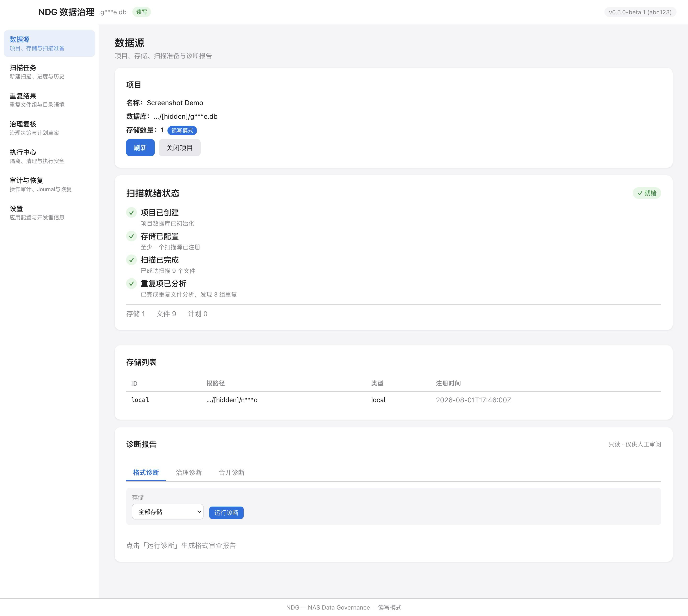
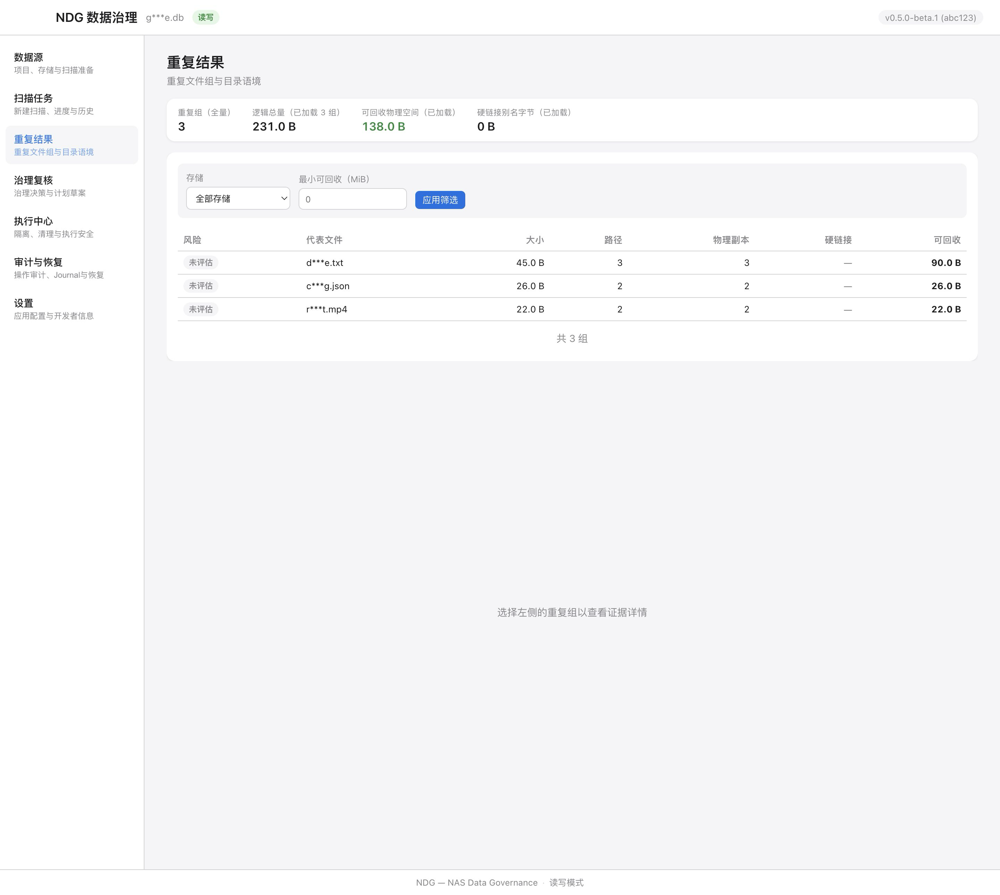

# NDG · 本地优先的数据治理工作台


**扫描、理解、复核与管理你的 NAS 和本地文件。数据由使用者掌控，任何具有破坏性的文件操作都必须有明确授权。**

NDG（NAS Data Governance）面向个人、家庭与组织的数字资产管理。项目采用本地优先设计、分层哈希识别重复内容、目录职责保护及可审计的操作生命周期。

> **当前有两个公开测试渠道，能力并不相同。** macOS Beta 支持经过明确批准的隔离与恢复；Docker Public Preview **只能扫描与查看结果，不能移动、隔离、恢复或删除源文件**。永久清理（Purge）目前在公开版本中禁用。新一代双端完整治理执行能力正在规划与验证，不要把 main 的实验能力视为已发布功能。

**English:** Local-first NAS data governance. Public macOS beta and read-only Linux Docker preview. File isolation/restoration require explicit authorization; permanent deletion is not enabled in current public releases.

## 公开版本与下载

| 渠道 | 当前公开版本 | 已支持 | 主要限制 |
| --- | --- | --- | --- |
| **macOS 桌面** | [v0.5.0-beta.11](https://github.com/FNB2026/nas-data-governance/releases/tag/v0.5.0-beta.11) · Public Beta | 扫描、重复候选分析、治理计划、经审批的 Quarantine / Restore | 仅 macOS 13+ / Apple Silicon；Purge 后端禁用；新 Governance UX v2 的 Mac 安全源核验仍在研究 |
| **Linux Docker** | [v0.5.0-docker-preview.1](https://github.com/FNB2026/nas-data-governance/releases/tag/v0.5.0-docker-preview.1) · Public Technical Preview | 本地源只读扫描、取消/断点恢复、持久化、认证 Web 聚合查看 | AMD64/ARM64；Web 最多展示 200 组；不可执行隔离、恢复、永久删除或治理意图记录 |
| **fnOS** | 尚无独立公开正式支持版本 | Docker Preview 在 fnOS AMD64 宿主上完成有限隔离测试 | 客户端访问入口仍 BLOCKED；仅为实验性兼容性证据，不代表可直接安装使用 |
| **Mac App Store / 原生 FPK** | 未发布 | 平台适配研究中 | 不得将工程样例或开发构建视为可安装正式版 |

[全部 GitHub Releases](https://github.com/FNB2026/nas-data-governance/releases) · [Docker 安装与限制](docs/multichannel/DOCKER-READONLY-PREVIEW.md) · [多渠道最新状态](docs/multichannel/RELEASE-STATUS.md) · [能力矩阵](docs/multichannel/CAPABILITY-MATRIX.md)

## 产品界面

下面是桌面端的合成数据示例截图，**不是 Docker Web 界面的截图**，不表示所有展示功能都已经在公开版本交付。

| 数据源与扫描 | 重复文件与目录语境 |
| --- | --- |
|  |  |

Docker 的真实浏览器验收截图可在 [Docker 公开预览版 Release](https://github.com/FNB2026/nas-data-governance/releases/tag/v0.5.0-docker-preview.1) 中查看（`readonly-web-actual-host.png`）。

## 为什么 NDG 不自动删除重复文件？

**内容相同，不代表可以安全删除。** 原始素材、工作副本、备份和归档即使哈希相同，承担的目录职责也可能不同。NDG 的治理原则是先理解关系和保护边界，再让用户确认操作。

- 分层哈希与重复候选分析；完整内容校验并非默认覆盖每个普通单例文件。
- 目录语境、重要副本、保护规则和人工复核。
- 计划、审批、新鲜度校验、执行、审计及保守崩溃恢复。
- 源目录或执行状态未知时拒绝动作，而不是猜测目标或自动清理。

### 操作语义（不要混淆）

| 操作 | 含义 | 当前公开渠道 |
| --- | --- | --- |
| **扫描 Scan** | 读取并分析，不修改源文件 | Mac 与 Docker |
| **隔离 Quarantine** | 经批准将文件移入管理隔离区，仍可恢复 | Mac Beta 有条件支持；Docker 未开放 |
| **恢复 Restore** | 经核验把隔离内容恢复到被允许的位置 | Mac Beta 有条件支持；Docker 未开放 |
| **永久清理 Purge** | 从受管理隔离区执行不可逆删除，需单独的高风险审批与证据 | **两个公开渠道均未开放** |

正在推进跨渠道的完整隔离／恢复／永久删除，但不会通过简单解除 Docker 只读挂载、关闭安全门禁或绕过 macOS 挂载边界核验来实现。开发中的 UX v2、新平台执行器和审批机制不能混同于已发布功能。

## 快速安装

### macOS 桌面版

支持 macOS 13+、Apple Silicon。打开 [beta.11 发行页](https://github.com/FNB2026/nas-data-governance/releases/tag/v0.5.0-beta.11)，下载 `NDG-0.5.0-beta.11-macos.dmg` 及校验文件，核对 SHA-256 后按正常 macOS 安装流程打开。

此版本已签名并公证。不要通过关闭 Gatekeeper 或移除隔离属性来绕过系统安全提示。首次安装建议联网；**全新 Mac 离线首次安装尚未通过实测**，这是明确披露的发行豁免，而非测试 PASS。真实资料操作前请保留独立备份。

[桌面使用指南](docs/user-guide/NDG-用户指南.md) · [beta.11 发行限制](https://github.com/FNB2026/nas-data-governance/releases/tag/v0.5.0-beta.11)

### Docker 只读技术预览

支持 Linux AMD64/ARM64 的**本地、明确授权源目录**，不认证 SMB/NFS/FUSE 或直接公网访问。建议先使用人工创建的测试文件。

从 [Docker Preview.1 发行页](https://github.com/FNB2026/nas-data-governance/releases/tag/v0.5.0-docker-preview.1) 获取 `INSTALL.md`、`compose.yaml`、`SHA256SUMS` 和固定版本归档。也可以匿名拉取固定 OCI digest：

```sh
docker pull ghcr.io/fnb2026/ndg-readonly-preview@sha256:49dada73f1eb9cc74485ed5d0b92023d7cb4c3df462d03e105f00158b91668e1
```

**不要直接使用不带参数的 Compose 命令。** 必须先按照 [Docker 安装手册](docs/multichannel/DOCKER-READONLY-PREVIEW.md) 创建私有凭据、独立状态目录、明确人工源路径和受保护访问入口。现有模板不发布端口，通过经授权的 SSH 本地转发访问；某些 fnOS 主机禁止转发，此时应保持 BLOCKED，不绕过主机策略。

Docker 镜像**未签名，构建重现性尚未认证**；可通过发行页的校验文件、OCI digest 和公开双架构拉取回执独立核对。

## 项目安全边界

- 默认以只读扫描开始；读取权限不是文件隔离、恢复或删除授权。
- 已批准的文件动作需重新核对目标、操作身份、保护规则、计划状态、恢复锁和审计。
- 禁止默认全选删除、隐式解除 Recovery Lock 和跳过独立备份。
- 用户数据、源文件和私有诊断日志不得上传到公开 Issue。
- 发行版与主干源码、真实宿主测试、模拟测试之间的验证结论保持独立。
- 没有承诺自动更新、零风险恢复或对所有 NAS 文件系统的通用支持。

[安全政策](SECURITY.md) · [支持入口](SUPPORT.md) · [公开边界](docs/open-source-boundary.md)

## 进度、参与与文档

| 需要做什么 | 对应入口 |
| --- | --- |
| 查看发行版 | [GitHub Releases](https://github.com/FNB2026/nas-data-governance/releases) |
| 了解多端支持及发布状态 | [多渠道发布台账](docs/multichannel/RELEASE-STATUS.md) |
| 阅读能力限制 | [能力矩阵](docs/multichannel/CAPABILITY-MATRIX.md) |
| 了解桌面端功能 | [用户指南](docs/user-guide/NDG-用户指南.md) |
| 了解 Docker Preview 的安装和安全边界 | [Docker 安装说明](docs/multichannel/DOCKER-READONLY-PREVIEW.md) |
| 反馈缺陷与需求 | [GitHub Issues](https://github.com/FNB2026/nas-data-governance/issues)（仅提供脱敏、合成复现数据） |
| 私密报告安全问题 | [安全政策 / GitHub Security Advisory](SECURITY.md) |
| 参与开发 | [贡献指南](CONTRIBUTING.md) · [开发护栏](AGENTS.md) · [文档索引](docs/README.md) |

### 开发环境与主要技术

Go（以 `go.mod` 为准）· SQLite · Wails v2 / React / TypeScript · Linux Docker/OCI · GitHub Actions。技术和实现的完整来源，以对应源码提交和发行说明为准。

```sh
git clone https://github.com/FNB2026/nas-data-governance.git
cd nas-data-governance
make test
make vet
go test -race -count=1 ./...
make public-check
```

## 开源许可与品牌

项目代码和构建文件遵循 [Apache-2.0](LICENSE)，原创文档遵循 [CC BY 4.0](LICENSE-DOCS.md)，第三方组件遵循 [第三方声明](THIRD_PARTY_NOTICES.md)。

NDG 名称、Logo 和品牌素材不随上述许可自动授权。当前桌面应用的图标源文件为 [appicon.png](cmd/ndg-desktop/build/appicon.png)；不同分发渠道的历史资产保持不变，品牌更新只作用于后续版本。

---

本页是**当前对外产品入口**。保留历史发布和失败证据，但不将旧文档中某个时间点的 Draft / BLOCKED 状态误写成当前公开版本状态。
