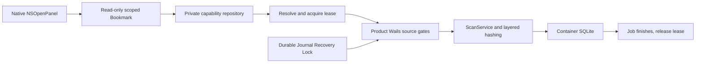

# Mac App Store Phase 1A — product read-only authorization layer

## Decision and identities

Implementation and limited local sandbox validation are ready for a **Draft PR**. The complete runtime acceptance matrix remains **INCONCLUSIVE**: no effective GUI interruption/cancel window was captured, actual stale Bookmark / system revocation are not certified, and the source relocation toast was not captured reliably. Do not declare the entire Phase 1A Gate PASS or store readiness.

- Phase 0 PR #86: independently reviewed, corrected shutdown/modal races, merged as `612bf3ca25e95621080b9b0cb40328ac6e89c256`. Exact pre-merge HEAD `b5b74acd7398386058b172b514236ce93a441dfc` had CI/Security SUCCESS. Local post-merge full Go/race/vet/build/public/version/release checks PASS; main CI SUCCESS and manually dispatched Security run `38190209729` SUCCESS.
- Phase 1A base: that latest main. Independent worktree/branch `codex/mas-phase1a`; original worktrees and Phase 0 evidence preserved.
- Reviewed/tested product code: `80e8a8ccb137e9d9f99c15e0c75e28cb580ba40e`. Subsequent report/CI/build-asset wiring does not change this product code. Private provenance records the actual source-file hashes.
- Local sandbox bundle: `com.fnb.ndg.mas.phase1a`, **dev**, ad hoc signed, Go 1.26.9 / Wails 2.13.0 / Xcode 26.6, Apple Silicon macOS 26.6.2. It uses the actual product main, React interface and Wails API, not the Phase 0 Probe interface. No MAS profile/distribution certificate/upload/review.
- Final tested executable SHA-256: `e496f908ec3eef2190f1c74980ff9a6a4d26fc6591575ebb1dabdb51d029e734`.
- Existing published v0.5.0-beta.11 RC `791f19119542e69b62ee62dd358fed188000837e`, Tag, DMG and release assets unchanged. The independent icon change is a separate source-asset PR, not a replacement of that release.

## Security design

`internal/fileaccess` has no Wails binding. `internal/macaccess` has no executable file-writing API. Bookmark data never enters frontend DTOs. The picker returns only the canonical selected root; subsequent calls must find a protected record and resolve its app-scoped Bookmark, not rely on the supplied path.

Each resolution creates an independently retained NSURL lease. C allocations are freed by Go; NSURL scope start/stop and retain/release are balanced by an idempotent release closure. Selection releases its lease after persistence. Async scanning owns the lease until progress workers and job persistence finish; cancellation and failed startup release it too. Concurrent MAS scans are refused because the existing ScanService has shared progress state; independent lease borrowers remain reference-safe.

The repository is private (0700 directory / 0600 files), size-bounded, rejects unsafe directories, symlink records and file-identity substitution. Updates use private temporary files, file Sync, rename and directory Sync. Root path, native filesystem identity and network classification must match; local identity is device/inode, network identity mount source/inode. Mount-source identity is a consistency check, **not cryptographic server authentication** or a certified general migration scheme. Relocated/replaced sources require a fresh explicit grant. Bookmarks are regenerated after successful resolution; actual stale=true behavior has not been observed.

OnBeforeClose coordinates shutdown while Wails' main loop is active: cancel lifecycle, cancel/lock out native panels, reject new work, drain leases and scans, then close SQLite. Shutdown is a package-level composition function, not a frontend-callable API method. Forced process termination relies on OS teardown and existing durable recovery semantics; it is not an orderly-close test. Synchronous native/SMB syscalls have no proven hard deadline; a stuck kernel read can make safe exit wait.

## State and side-effect invariants

1. No authority means no source probe, project creation/registration, scan job or source reconciliation. Repository lookup precedes arbitrary source path inspection.
2. Database opening/validation in MAS is restricted to regular `projects/.../governance.db` files in its own container with safe parent directories. External DB import is intentionally not implemented; the read-write source grant is not reused for SQLite.
3. `AUTHORIZATION_REQUIRED` covers invalid/denied grants and permission errors. `SOURCE_UNAVAILABLE` covers a local source that is absent. `NETWORK_PAUSED` covers a saved network source whose volume is actually unavailable. Valid bookmark metadata plus actual saved-root mount state distinguishes unmounted volumes from malformed bookmarks; raw NSError/paths are never returned.
4. Mid-scan authority is rechecked before missing/unavailable reconciliation. Permission failures in traversal, hashing and Resume prefix validation also classify explicitly. Authorization loss keeps the checkpoint resumable (`aborted`) and emits `PAUSED_AUTHORIZATION`; network loss uses `paused_network` / `PAUSED_NETWORK`. Failure to persist a pause is FAILED, not falsely certified safe completion.
5. The authorization-only pause never clears an uncertain execution Journal or durable Recovery Lock. Reauthorization permits reads only after the independent recovery-lock check passes.
6. MAS Create/Approve/Execute Restore and Purge, Quarantine execution, filesystem recovery operations and source-reading diagnostics are backend-denied before their effects. History, indexed results and lock queries remain readable. Diagnostics are conservatively deferred until their capability boundaries are implemented. No UI parameter or environment variable enables source writes.
7. `mas` is a build-time policy; even NewAPI without a repository defaults to deny in that build. Legacy picker injection cannot supply authority. Default builds retain the GitHub API policy, capabilities and normal processing. No migration/dependency/version change.
8. A timed-out preflight's separate borrowed lease is released by the **actual IO worker**, not by the timed-out caller. No source access is revoked beneath an unfinished syscall.

## Automated evidence

Initial package/API contract tests were added before implementation and failed to compile against the absent authorization layer; this is not evidence of a pre-existing DMG defect. Independent review later found a real Phase 1A classification gap: prefix permission denial returned generic FAILED. `TestResumePrefixPermissionDenialIsAuthorizationPause` was actually RED with `resume candidate validation failed`, then GREEN after correction. It executed on this non-root host, not SKIP. Native errno is now captured before Cocoa cleanup can alter it.

| Coverage | Actual result |
|---|---|
| Missing/corrupt record, private repository/symlink substitution | PASS |
| Selection persistence, new Manager/restart, repeated release, concurrent leases, close waits | PASS |
| Local unavailable vs network unavailable vs permission denied classification | PASS |
| MAS default constructor, legacy picker injection and all bound filesystem execution/recovery/diagnostic entry points | PASS |
| Product project creation/open, repeated Resume/reopen, immutable coverage | PASS |
| Late lost authority before reconciliation, durable prefix permission denial, explicit paused job state | PASS |
| Lifecycle cancellation, resource cleanup and persistent terminal result | PASS |
| Reauthorization preserves EXECUTING plan / Recovery Lock | PASS |
| Native malformed/cancelled Bookmark resolution (tagged production build) | PASS |
| Full Go test, vet, CLI build, full race, public/version/release checks | PASS |
| Frontend tests and build | PASS — 261 tests |
| New Darwin MAS-specific CI step | Added; remote exact-PR result tracked on PR, not substituted for GUI proof |

Independent source reviewer checked `80e8a8c...`, including per-lease memory, persistence, source/DB/API guards, default DMG behavior and the corrected early-error branches. No remaining source safety blocker found. Reviewer independently ran three reconciliation/cancellation/prefix tests; all PASS. Runtime claims below remain separate.

## Actual product GUI / filesystem evidence

All sources were generated for this phase, outside real NAS and historic projects. Two distinct read-only loopback SMB servers used ports 3445 and 4445; only their own mounts/services were manipulated. Three new container projects indexed 7 files each (three duplicate pairs plus a singleton). A second fixture contained larger synthetic files to attempt observation of interruption. All **28 artificial source file hashes and file sets** across the two fixture manifests remain equal to their saved baselines; transient local POSIX mode and directory rename were restored. No App Quarantine/Restore/Purge or real source writes.

| Scenario | Observation | Result / limit |
|---|---|---|
| Native picker / first local and SMB scans | Actual product interface; 7 files / 7 quick / 6 full / 3 groups | PASS |
| Local normal quit/relaunch, DB reopen, no new picker | Rescan completed 7/7; singleton remains without full hash | PASS |
| SMB Bookmark after normal quit/relaunch | Reopened container DB and scanned without fresh selection | PASS |
| Saved SMB volume unmounted | Explicit network-source unavailable/pause notification; no new job | PASS after native classification correction; original generic authorization observations retained |
| Same share/path remounted | Saved Bookmark reused; natural COMPLETED 7/7 | PASS for this local SMB server/mount combination |
| Unselected artificial source typed into actual scan field | AUTHORIZATION_REQUIRED, no new job | PASS; no raw generic file-open endpoint exposed |
| Deliberately corrupt private grant, with its own backup | AUTHORIZATION_REQUIRED; original private grant restored | PASS; not system-level revocation |
| Actual local POSIX permission denial | Authorization refusal before scanning; restored mode and later natural COMPLETED 7/7 | PASS; not TCC/OS security-scope revocation |
| Local source temporarily moved | Refused/no added job; precise toast not captured reliably | INCONCLUSIVE runtime classification; automated relocated-root test PASS |
| Enlarged SMB scan cancellation window | Completed before next GUI sample; no effective cancellation injected | INCONCLUSIVE — no GUI Cancel/Resume PASS claim |
| Different mount source / mountpoint identity | Unit guard and source identity comparison | Runtime NOT RUN; same-share remount is not equivalent |
| Stale Bookmark, system permission revocation, active picker close, truly stuck IO | Not certified | NOT RUN / INCONCLUSIVE |

Final **closed** DB copies: three `integrity_check=ok`, each active=7, quick=7, full=6, missing/unavailable=0, all observed checkpoints completed/count=7. Local project had 3 completed jobs; interruption fixture 1; ordinary SMB 2. Failed authority checks added no jobs. Some live/closed Python mode=ro connections could not open WAL databases; closed, synced snapshots were therefore checked with `mode=ro&immutable=1`, not an immutable view of a live WAL. A malformed local evidence-query URI created empty disposable tooling files; they were moved into the private archive, not used as DB evidence. No product DB was edited to manufacture results.

Private AX text, screenshot, original grant backup, closed snapshots, test/build logs and provenance are retained locally (0700 archive, 0600 files). No private source path, filename record, Bookmark, DB or raw log is committed. Native signature verification confirms only the four read-only sandbox entitlements.

## Privacy evidence and limits

Scoped capture: stdout/stderr zero bytes; App-name unified stream 61,544 lines / 70,103,723 bytes. Twenty-two deduplicated synthetic path/file/content marker variants: zero hits. Sixty-seven private job-event payloads: source-path/filename markers zero hits. This is **limited evidence**, not a release privacy Gate: first GUI launch preceded capture, builds/restarts introduced distinct App segments, a complete PID/liveness continuity receipt was not maintained, WebKit child-process coverage is not certified, and no long-load/full-system claim is made. GUI/index/bookmark metadata are explicitly private and excluded from ordinary-log checks.

## Reproduction and next dependencies

- Build local product sandbox with `scripts/mas/build-phase1a.sh`; it uses separate plist/build directory and a `mas`-tagged generated copy of the actual main, with the product frontend and backend. Generated staging/output are ignored. The canonical product icon is copied to this distinct build directory to avoid framework fallback; image-only source update is separately reviewed.
- Reproduce synthetic source preparation/mount/hash checks with `scripts/mas/fixture.py` and **new manifest names and unused loopback ports** as in Phase 0 README. Do not overwrite historical manifests. Server dependencies remain external isolated tooling, not product dependencies.
- Go checks: ordinary full suite/race plus `go test -race -tags 'mas,production' ./internal/macaccess`, and `go test -race -tags mas -run 'TestSandbox|TestReauthorization|TestMASDefault|TestAllSandbox' ./internal/adapters/wails`.
- Reopen only a new container project; select its source via NSOpenPanel. Back up only its grant for corruption tests. Never modify historic grants/DBs, official signed Apps or existing shares.
- After tests, normal-quit the App, close/snapshot DBs, restore fixture modes/paths/grants, verify all hashes, unmount exact disposable shares and stop exact service PIDs. Those cleanup steps completed; original evidence retained.

Next Phase 1B should close actual interruption/cancel + repeated Resume, stale/system-revoked grants, different mount source, active modal shutdown and native syscall behavior, with observer setup before GUI actions and deterministic disposable IO delay. Add a reviewed explicit source-reselection UX/status contract and blocked external-project import design. Write-capability design, Quarantine/Restore safety, broader privacy/public API audit and real MAS certificates/profile/packaging remain separate later work. No App Store upload or public review was requested or performed.
